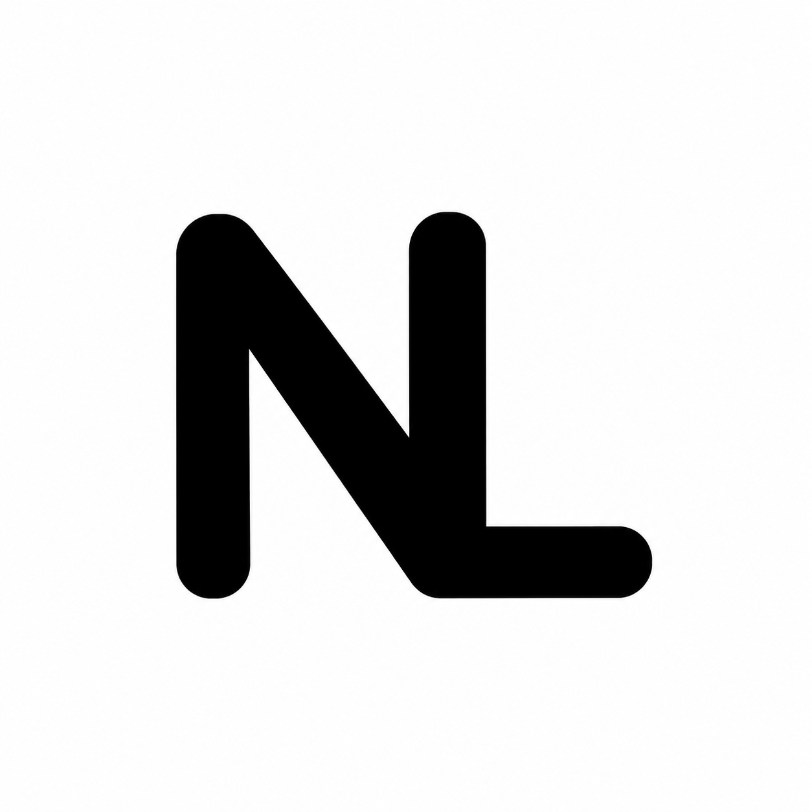
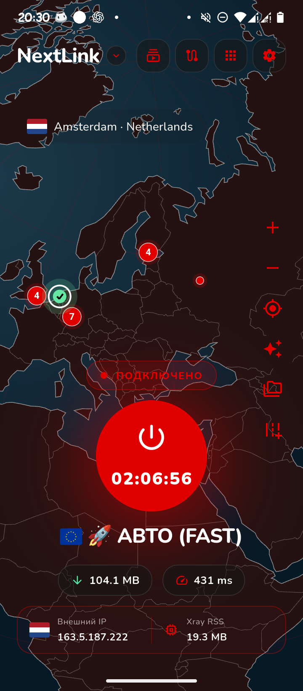

<div align="center">



# Nextlink

**VPN-клиент для Android, который даёт управлять подключением, а не бороться с настройками.**

Подписки · Xray · sing-box · AmneziaWG · маршрутизация · собственные темы

[](https://flutter.dev/)   [](.github/workflows/workflow.yml) [](LICENSE)

**[Возможности](#возможности) · [Сборки](#original-и-shadow) · [Установка](#установка) · [Разработка](#разработка) · [English](docs/README.en.md)**

</div>

---

<table>
<tr>
<td width="62%" valign="top">

## Что это

**Nextlink** — разрабатываемый на Flutter VPN-клиент с нативной Android-интеграцией. Он умеет работать с несколькими движками, импортировать конфигурации и подписки, настраивать правила соединений и внешний вид интерфейса.

Проект находится в стадии **beta**: функции могут меняться, а стабильность на разных прошивках Android ещё проверяется.

**Никаких VPN-серверов в комплекте нет.** Для подключения нужна своя конфигурация или подписка на совместимый сервис.

</td>
<td width="38%" align="center" valign="top">

</td>
</tr>
</table>

## Возможности

| | |
|---|---|
| **Три движка** | Xray, sing-box и отдельный AmneziaWG/Amnezia Box. |
| **Подписки и импорт** | Добавление конфигураций, ссылок и JSON; обновление подписок. Поддержка WireGuard/WARP/AWG-конфигураций — см. [подробности](docs/themes-and-tunnels.md). |
| **Маршрутизация** | Правила для приложений и соединений, DIRECT/обход LAN, управление DNS и IPv6. Доступность зависит от движка и версии Android. |
| **Управление подключением** | Переключение серверов, системная VPN-служба, плитка быстрых настроек и уведомления. |
| **Интерфейс** | Глобус, светлая/тёмная темы, настройка оформления и импорт/экспорт тем `.nlt`. |
| **Диагностика** | Логи, сведения о соединении, статистика трафика и Центр ресурсов для управления ядрами и правилами. |

> Функции не равнозначны для всех движков. Некоторые режимы требуют определённого формата конфигурации или поддержки Android. Это **не** приложение со встроенным бесплатным VPN-доступом.

## Original и Shadow

Один клиент, две редакции. В обеих версиях одинаковые интерфейс и функции; различается способ поставки ресурсов.

| | **Original** | **Shadow** |
|---|---|---|
| APK | `NextLink-arm64-v8a.apk` | `NextLink-arm64-v8a-s.apk` |
| Ядра VPN | При необходимости загружаются | Встроены в APK |
| GeoIP / GeoSite | Загружаются | Входят в комплект |
| Первый запуск без загрузки ядер | Нет | Да, при корректной установке встроенных компонентов |
| Размер APK в beta+4¹ | ≈35,8 МБ | ≈84,3 МБ |

<sub>¹ Размеры из локальной сборки Android ARM64; будущие релизы могут отличаться. Размер установленного приложения больше размера APK.</sub>

**Пока фокус — Android ARM64.** Linux и другие архитектуры не входят в текущий релизный CI. Не скачивай Shadow только ради «ускорения VPN»: движки у редакций одни и те же.

## Установка

1. Открой раздел **Releases** этого репозитория и выбери APK для своего устройства.
2. Установи Nextlink и предоставь системное разрешение VPN при первом подключении.
3. Добавь собственную подписку или конфигурацию.
4. Выбери сервер, проверь настройки и подключайся.

Если приложения **ещё нет в Releases**, значит публичный APK не опубликован — см. раздел сборки ниже.

**Важно про обновления:** Original и Shadow имеют один `applicationId`. Переход без удаления данных возможен только при совместимой подписи и `versionCode`. Сборка с новым release-ключом не установится поверх старой debug-подписанной версии.

## 🌐 Где взять VPN-подписку?

Nextlink — независимый VPN-клиент, поэтому серверы и подписки не входят в комплект приложения.

Если у тебя ещё нет своего VPN, можешь воспользоваться **VPN-KA** — сервисом с готовыми подписками для подключения через Nextlink.

<p align="center">
  <a href="https://t.me/vpnka_official_bot?start=utm_nextlink">
    
  </a>
</p>

Подписку можно получить через Telegram-бота VPN-KA, а затем импортировать её в Nextlink.

> **VPN-KA — отдельный сервис.** Nextlink также поддерживает совместимые конфигурации и подписки других провайдеров.

## Разработка

Требуются Flutter SDK, Android SDK/JDK и окружение Android-сборки.

```bash
# Клонируй репозиторий и подмодуль TUN bridge
git clone --recurse-submodules https://github.com/OWNER/REPO.git nextlink
cd nextlink
flutter pub get

# Анализ и офлайн-тесты
flutter analyze --no-fatal-infos --no-fatal-warnings
flutter test test/core/models test/core/utils test/core/engine test/core/localization --exclude-tags network
python3 -m unittest discover -s test/python -v

# Android Original, debug
flutter build apk --debug --flavor original --target-platform android-arm64
```

В команде `git clone` замени `OWNER/REPO` на путь своего GitHub-репозитория. Проверка с реальной сетью (`test/core/xray_download_test.dart`) запускается отдельно и может зависеть от доступности GitHub API.

Для signed release и Shadow payload см. **[руководство по Android-релизам](docs/android-release.md)**. CI: [`.github/workflows/workflow.yml`](.github/workflows/workflow.yml).

### Что лежит в репозитории

```text
lib/              Flutter UI, экраны, провайдеры и логика клиента
android/          VPN-сервис, Android-интеграция, Gradle flavors
assets/           Локализации, темы, шрифты и карта
scripts/          Сборка Android и нативных компонентов
test/             Dart- и Python-тесты
tun2socks/        Upstream Git submodule
patches/          Изменения TUN bridge для Nextlink
docs/             Техническая документация
```

## Документация и участие

- **[Сборки, подпись и GitHub Actions](docs/android-release.md)**
- **[Темы, импорты и туннели](docs/themes-and-tunnels.md)**
- **[Как предложить изменение](CONTRIBUTING.md)**
- **[Как сообщить об уязвимости](SECURITY.md)**
- **[Архитектура патча TUN bridge](patches/README.md)**

Если нашёл баг, приложи шаги воспроизведения, версию Android и редакцию APK. **Не публикуй** ссылки подписок, ключи, приватные конфиги и неочищенные VPN-логи.

## Лицензия

Nextlink распространяется под лицензией [MIT](LICENSE).

Сторонние компоненты, включая Xray, sing-box, AmneziaWG и tun2socks, сохраняют собственные лицензии.

---

<div align="center">
<sub>Nextlink — независимый клиент. Упоминание сторонних движков и проектов не означает их официальное одобрение или связь с Nextlink.</sub>
</div>
