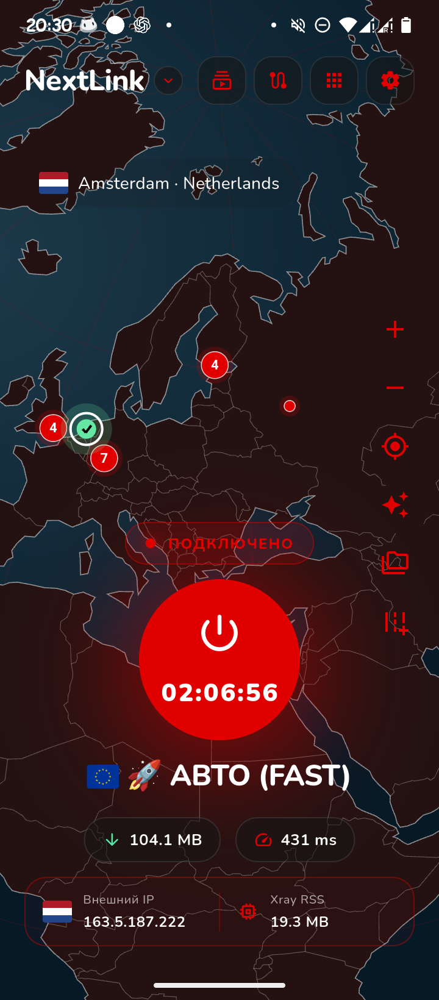

<div align="center">


# Nextlink

**A configurable VPN client for Android.**

Xray · sing-box · AmneziaWG · Subscriptions · Routing · Themes

[](https://flutter.dev/)


[Русский](../README.md) · [Android releases](android-release.md) · [Contributing](../CONTRIBUTING.md)



</div>

## Overview

Nextlink is a Flutter-based Android VPN client with native VPN integration. It supports multiple engines, configuration and subscription import, routing controls, connection diagnostics, and customizable `.nlt` themes.

**Nextlink does not include VPN servers or an account.** Bring your own configuration or compatible subscription. This is beta software; device-specific behavior and feature support can vary.

## Features

- **Engines:** Xray, sing-box, and AmneziaWG / Amnezia Box.
- **Configuration:** JSON, subscription links, and supported WireGuard/WARP/AWG imports.
- **Networking:** app/routing rules, DNS and IPv6 options, LAN bypass controls (platform-dependent).
- **Android:** VPN service, Quick Settings tile, notifications, logging, traffic diagnostics.
- **Personalization:** globe interface, themes, `.nlt` import/export, language options.

## Two Android editions

| | Original | Shadow |
|---|---|---|
| ARM64 filename | `NextLink-arm64-v8a.apk` | `NextLink-arm64-v8a-s.apk` |
| VPN engines | Download as needed | Included in the APK |
| GeoIP / GeoSite | Downloaded | Bundled |
| Observed beta+4 APK size | ~35.8 MB | ~84.3 MB |

Both editions share the same app identity and features. Switching editions without reinstalling requires compatible signing and version codes. Current release automation targets **Android ARM64**; Linux release packaging is on hold.

## Getting started

Find an APK under the repository's **Releases** section (when available), install it, grant the Android VPN permission, and add your own subscription or configuration. No subscription is shipped with the app.

To build the Original debug edition:

```bash
flutter pub get
flutter analyze --no-fatal-infos --no-fatal-warnings
flutter build apk --debug --flavor original --target-platform android-arm64
```

For signing, Shadow assets and GitHub Actions, see [Android release guide](android-release.md). For contributions and responsible disclosure, see [CONTRIBUTING](../CONTRIBUTING.md) and [SECURITY](../SECURITY.md).

<sub>Nextlink is independent from the upstream projects whose engines it integrates.</sub>
